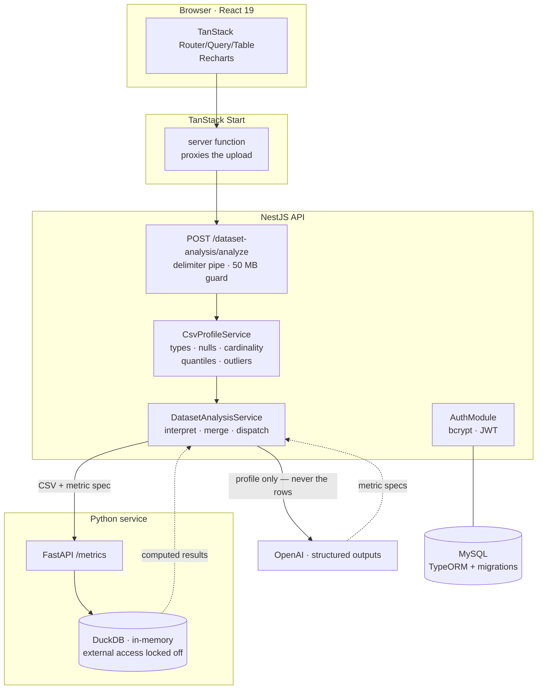

# Dataset Analyzer

Upload a CSV, get back a statistical profile of every column, an LLM's reading of what
those columns *mean*, and the metrics it proposed — actually computed against your data.

The interesting constraint: a language model is good at saying "`unit_price × quantity`
is probably line revenue, and it's worth slicing by region" and bad at arithmetic over
200,000 rows. So the model never sees the data and never reports a number. It sees a
compact statistical profile, proposes metrics as SQL expressions, and DuckDB executes
them. Every figure the user sees came out of a query engine; only the interpretation came
out of the model.

---

## Contents

- [How it works](#how-it-works)
- [Architecture](#architecture)
- [The trust boundary](#the-trust-boundary)
- [Running it locally](#running-it-locally)
- [API](#api)
- [Configuration](#configuration)
- [Design notes](#design-notes)
- [Project layout](#project-layout)
- [Status and roadmap](#status-and-roadmap)

---

## How it works

A single request walks through four stages:

**1. Profile (NestJS, `csv-parse`).** The CSV is parsed and reduced to a `DatasetProfile`:
row and column counts, and per column — inferred type, null count and fraction, distinct
count and fraction, three sample values. Numeric columns also get min, max, mean, p50,
p95, standard deviation, and a count of values more than three standard deviations from
the mean. Columns with 50 or fewer distinct values get their top values by frequency.

Real exports are rarely well-formed, so the parser tolerates the two most common defects
— rows with extra or missing trailing delimiters, and bare quote characters inside
unquoted fields — and reports how many rows it had to drop as `skippedRowCount` rather
than failing the whole upload on line 12,000. Profiling truncates at 200,000 rows by
default but still reports the true row count, with `truncated: true` so nothing downstream
mistakes a sample for the whole file.

**2. Interpret (OpenAI structured outputs).** The profile — not the data — goes to the
model, which returns a Zod-validated object: the dataset's domain, what one row
represents, primary key candidates, the time column, a semantic role and description and
PII flag per column, and a list of metrics. Each metric carries a SQL-like expression, the
columns it requires, the columns it's worth broken down by, and a confidence level.

The system prompt scopes the model to semantic interpretation only: reference columns
verbatim, never invent one, don't restate statistics that are already computed and
authoritative, and prefer a few well-grounded metrics to a long speculative list. If the
model omits a column that was in the profile, the request fails with a 422 rather than
silently returning a partial result.

**3. Compute (FastAPI + DuckDB).** The CSV and the metric spec are handed to the Python
service, which loads the file into an in-memory DuckDB table and runs each metric
expression as a query — once overall, then once per suggested breakdown column as a
`GROUP BY`. A metric that references a column that isn't there is marked `skipped`; one
whose SQL fails to execute carries its `error` and doesn't take the rest of the response
down with it.

**4. Render (React 19 + TanStack).** A TanStack Start server function proxies the upload
to Nest, keeping the API origin and any future credentials off the browser. Results render
as a sortable column table (TanStack Table) and metric charts (Recharts).

---

## Architecture



Two runtimes, split along a real boundary rather than by preference. Node owns the edge:
HTTP, multipart handling, validation, auth, the model contract. Python owns dataframe
work, because that's where DuckDB's bindings, pandas, and the profiling ecosystem live —
and where the heavier profiling on the roadmap belongs. The contract between them is one
multipart POST with a camelCase JSON spec, mirrored by Pydantic models on the Python side
and TypeScript interfaces on the Node side, so a drift in either direction surfaces as a
422 instead of a wrong number.

The Python service began as a straight port of an equivalent DuckDB runner in Node
(`src/dataset-analysis/metricAnalysis/metric-analysis.service.ts`, kept so the two paths
can be diffed on the same input before the Node one is deleted).

---

## The trust boundary

`metric.expression` is written by a language model and executed as raw SQL. That is
deliberate — the model emits SQL-like expressions and DuckDB is the executor — so the
safety guarantee comes from one ordering rule in `MetricRunner.run`:

1. `read_csv(...)` loads the uploaded file **while** `enable_external_access` is on.
2. `SET enable_external_access = false` locks the connection **before** any model-authored
   expression runs.

After step 2, an expression like `(SELECT COUNT(*) FROM read_csv('/etc/passwd'))` fails
with a permission error instead of reading the filesystem. Both the Node and Python
runners enforce the same ordering.

The constraints around it:

- Each request gets a fresh `:memory:` DuckDB connection, closed in a `finally`; temp
  files are unlinked on both the success and failure paths.
- Breakdown column names are double-quoted as identifiers, and the file path and delimiter
  are escaped before interpolation.
- Breakdowns are skipped above 100 distinct values and capped at 50 rows, so a
  high-cardinality `GROUP BY` can't be used to force an enormous result set.
- Uploads are capped at 50 MB and profiling at 200,000 rows.

If you change `metrics.py` or `metric-analysis.service.ts`, don't move the `SET` above the
load — `read_csv` would be blocked — and don't run any expression before it.

---

## Running it locally

Three processes plus MySQL. Each needs its own terminal.

**Prerequisites:** Node 20+, Python 3.11+, MySQL 8, an OpenAI API key.

```bash
# 1. Python metric service → :8100
cd python-service
pip install -r requirements.txt
uvicorn app.main:app --port 8100 --reload

# 2. NestJS API → :8000
npm install
cp .env.example .env     # then fill in DB credentials, JWT_SECRET, OPEN_AI_KEY
npm run migration:run
npm run start:dev

# 3. Frontend → :3000
cd frontend
npm install
npm run dev
```

Open http://localhost:3000 and upload a CSV.

Check the Python service is up with `curl localhost:8100/health` → `{"status":"ok"}`.

Redis is only needed once the async queue lands (see [roadmap](#status-and-roadmap));
`docker compose -f redis/docker-compose.yml up -d` starts it.

### Tests

```bash
npm run test       # unit
npm run test:e2e   # e2e
npm run test:cov   # coverage
```

---

## API

### `POST /dataset-analysis/analyze`

Multipart upload. Max 50 MB.

| Part / param | Type | Description |
| --- | --- | --- |
| `file` | file | The CSV or TSV. Required. |
| `delimiter` | query | `comma`, `tab`, `semicolon`, `pipe`, `space`, or any single character. Quotes and newlines are rejected. Defaults to `,`. |
| `row` | query | Zero-based index of a data row, for files with **no** header. The column count is read from that row and columns are named `column0…columnN`. Omit it when row 1 is a header. |

Response:

```jsonc
{
  "analyzedProfile": [          // statistical profile + the model's reading, per column
    {
      "name": "revenue",
      "inferredType": "float",
      "nullCount": 12,
      "nullFraction": 0.0024,
      "distinctCount": 4817,
      "distinctFraction": 0.9641,
      "sampleValues": ["129.99", "84.50", "310.00"],
      "numeric": { "min": 0.99, "max": 9800, "mean": 214.7,
                   "p50": 148.5, "p95": 712, "stddev": 203.4, "outlierCount": 37 },
      "semanticRole": "measure",
      "description": "Gross revenue for the order line, before discounts.",
      "unit": "USD",
      "isPii": false,
      "qualityIssues": []
    }
  ],
  "metrics": [                  // what the model proposed
    {
      "name": "Total revenue",
      "description": "How much money came in across all orders.",
      "aggregation": "sum",
      "expression": "SUM(revenue)",
      "requiredColumns": ["revenue"],
      "suggestedBreakdowns": ["region", "channel"],
      "confidence": "high"
    }
  ],
  "metricResults": [            // what DuckDB actually computed
    {
      "name": "Total revenue",
      "expression": "SUM(revenue)",
      "aggregation": "sum",
      "confidence": "high",
      "description": "How much money came in across all orders.",
      "overall": 1069483.52,
      "breakdowns": [
        { "column": "region", "rows": [{ "key": "EMEA", "value": 512903.1 }] }
      ]
      // "skipped": "references unknown column(s): discount"
      // "error":   "Binder Error: ..."
    }
  ],
  "caveats": ["Dates in `created_at` span only 2024-03 onward."]
}
```

Errors: `400` invalid delimiter · `413` file too large · `422` unparseable CSV, model
refusal, or a model/spec contract mismatch · `503` OpenAI or the metric service
unreachable.

### Auth

| Route | Description |
| --- | --- |
| `POST /auth/register` | Email + password. bcrypt, cost 10. Returns an access token. |
| `POST /auth/login` | Returns an access token. 6-hour expiry. |
| `GET /auth` | JWT-guarded. Returns the token's subject. |

### `POST /metrics` (Python service, internal)

Multipart: `file` (CSV) + `spec` (JSON). See
[`python-service/readme.md`](python-service/readme.md) for the full contract.

---

## Configuration

### NestJS API

| Variable | Default | Purpose |
| --- | --- | --- |
| `PORT` | `3000` | Set to `8000` to match the frontend's default `API_URL`. |
| `DB_HOST` / `DB_PORT` / `DB_USER` / `DB_PASSWORD` / `DB_NAME` | — | MySQL connection. |
| `JWT_SECRET` | — | Token signing secret. |
| `OPEN_AI_KEY` | — | Required at boot; the app throws without it. |
| `DATASET_ANALYSIS_MODEL` | `gpt-5.6-luna` | Model used for interpretation. |
| `DATASET_MAX_ROWS_PROFILED` | `200000` | Rows held for profiling; beyond this, `truncated: true`. |
| `DATASET_SAMPLE_ROWS` | `5` | Sample rows included in the profile sent to the model. |
| `DATASET_TOP_K` | `8` | Top values kept per low-cardinality column. |
| `DATASET_MAX_UPLOAD_BYTES` | `52428800` | 50 MB. |
| `PYTHON_ANALYSIS_URL` | `http://localhost:8100` | Metric service base URL. |
| `PYTHON_ANALYSIS_TIMEOUT_MS` | `30000` | Abort signal for the metric call. |

Schema changes go through TypeORM migrations (`npm run migration:generate`,
`migration:run`, `migration:revert`); `synchronize` is off in both the app module and
`data-source.ts`, so the database's shape lives in `src/migrations` and travels with the
code.

### Frontend

| Variable | Default | Purpose |
| --- | --- | --- |
| `API_URL` | `http://localhost:8000` | Where the server function forwards uploads. |

---

## Design notes

**The model is a translator, not a calculator.** Everything numeric is computed by DuckDB
or by the profiler. The model's output is constrained by a Zod schema and validated on
arrival, so a malformed or partial analysis is a 422 rather than a plausible-looking
response with a hallucinated column in it.

**Statistics before semantics.** Profiling first means the prompt is grounded in real
column names, types, and cardinalities, which is what keeps the proposed expressions
executable. It also keeps the prompt small and bounded no matter how large the upload is —
the model's input doesn't grow with the file.

**Partial results beat failed requests.** A malformed row is dropped and counted, not
fatal. A metric that references a column that isn't there is `skipped` with a reason. A
metric whose SQL fails carries its `error`. A breakdown that fails is logged and omitted
while the metric's overall value survives. The one thing treated as unrecoverable is a
contract violation — if the model omits a column, the whole response is suspect.

**Errors are mapped, not forwarded.** A 422 from the Python service means *our* spec
didn't validate, so it's logged as a bug on the Node side and surfaced as a contract
error. Transport failures and OpenAI `APIError`s become 503s. Upstream messages aren't
leaked to the client.

---

## Project layout

```
src/
  dataset-analysis/
    dataset-analysis.controller.ts     upload, delimiter pipe, size guard
    dataset-analysis.service.ts        profile → interpret → compute → merge
    data-analysis.config.ts            namespaced config factory
    profiler/
      csv-profiler.service.ts          types, nulls, cardinality, quantiles, outliers
      csv-profiler-delimter.pipe.ts    delimiter aliases + rejection rules
    schemas/
      dataset-analysis.schema.ts       Zod contract for the model's output
    metricAnalysis/
      metric-analysis.interfaces.ts    MetricRunner port
      metric-analysis.service.ts       DuckDB runner (Node; being replaced)
    python-metric-analysis.service.ts  DuckDB runner (HTTP → FastAPI)
  auth/                                bcrypt, JWT strategy, guard
  users/                               TypeORM entity + service
  migrations/                          versioned schema
  queue/                               BullMQ config (queue itself not yet wired)

python-service/app/
  main.py                              FastAPI: /health, /metrics
  metrics.py                           DuckDB execution + trust boundary
  models.py                            Pydantic mirror of the TS contract

frontend/src/
  components/AnaylzeForm.tsx           upload, delimiter, header-row controls
  components/results/                  ColumnsTable, MetricChart, MetricResults
  lib/api.ts                           TanStack Start server function
  types/api.types.ts                   mirror of the Nest response
```

---

## Status and roadmap

Working end to end: upload → profile → interpret → compute → render, plus registration,
login, and JWT issuance.

Deliberately not built yet:

- **Async job queue (BullMQ).** Analysis is synchronous today, which is fine at 50 MB and
  wrong at 5 GB. The Redis config and compose file are in place; the processor isn't.
- **Chat over a dataset.** Conversational Q&A against a profiled file — text-to-SQL
  grounded in the profile that already exists, reusing the same locked-down DuckDB
  execution path.
- **Deep profiling.** polars / ydata-profiling for distributions and correlations beyond
  what cheap DuckDB aggregates give, on top of the same loaded frame.

Known gaps:

- The analyze endpoint isn't behind `JwtAuthGuard` yet; auth exists but isn't enforced
  there.
- `UsersController` is scaffolding — the routes are stubbed out.
- Profiling holds parsed rows in memory rather than streaming the aggregates, which is
  what the 200,000-row ceiling is standing in for.
- CSV and TSV only.
